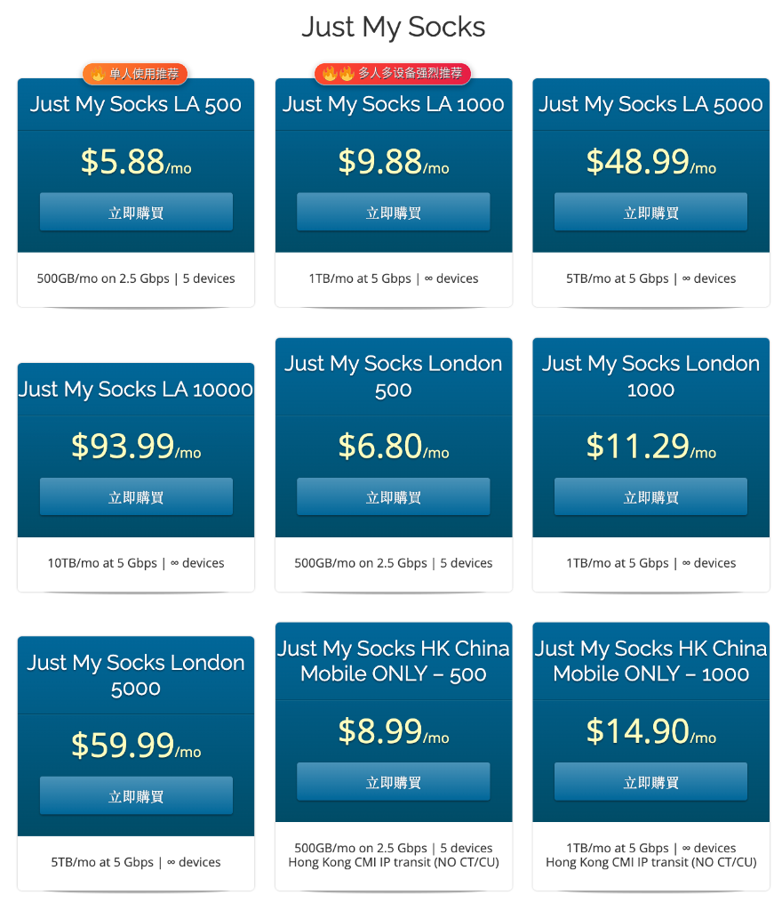

# Just My Socks 2026 中文指南：最新优惠码、套餐价格对比与购买教程

> **Just My Socks（JMS）选购与使用指南**  
> 汇总 Just My Socks 优惠码、洛杉矶 CN2 GIA、香港 IPLC、日本及英国线路套餐，提供价格对比、购买流程、客户端配置和常见问题解答。

[官方订购入口](https://justmysocks.net/members/aff.php?aff=2657) · [官方公告](https://justmysocks.net/members/index.php?rp=/announcements)

> 📌 **优惠码：`JMS9272283`**  
> 公开资料标注约 5.2% 循环折扣，是否适用及实际优惠金额请以订单结算页面为准。

## 📖 目录

- [一、Just My Socks 是什么？](#一just-my-socks-是什么)
- [二、2026 优惠码与购买教程](#二2026-优惠码与购买教程)
- [三、套餐价格与参数对比](#三套餐价格与参数对比)
- [四、如何选择适合自己的套餐？](#四如何选择适合自己的套餐)
- [五、CN2 GIA、IPLC 与普通线路的区别](#五cn2-giaiplc-与普通线路的区别)
- [六、客户端与协议支持](#六客户端与协议支持)
- [七、常见问题 FAQ](#七常见问题-faq)
- [八、更新记录与免责声明](#八更新记录与免责声明)

---

## 一、Just My Socks 是什么？

Just My Socks（简称 JMS）是一项与 BandwagonHost（搬瓦工）相关的托管式代理服务。

与自行购买 VPS、部署代理软件的方式不同，JMS 为用户提供已经配置好的节点和服务后台，减少服务器端的安装与维护工作。

### 主要特点

| 功能 | 说明 |
|---|---|
| 托管式节点 | 无需自行部署服务器端程序 |
| 多地区选择 | 提供洛杉矶、伦敦、香港、日本等地区套餐 |
| 网络线路 | 部分套餐采用 CN2 GIA、IPLC 或其他优化线路 |
| 节点维护 | 服务商提供相应节点和 IP 维护服务 |
| 客户端支持 | 根据节点协议使用兼容的客户端 |
| 订阅管理 | 部分客户端可通过后台提供的订阅资料导入配置 |

**需要注意：**

- 不同套餐可能采用不同的线路和协议。
- 节点数量、可用性及切换方式以实际服务为准。
- 代理服务不保证所有网站、AI 服务或流媒体始终可访问。
- 实际速度受到本地宽带、网络拥塞、服务端负载和访问目标等因素影响。

---

## 二、2026 优惠码与购买教程

### 🎁 Just My Socks 优惠码

**优惠码：`JMS9272283`**

公开资料中，该优惠码通常被描述为约 **5.2% 循环折扣**。

请在购买时确认：

1. 优惠码是否仍然有效。
2. 当前套餐是否参与活动。
3. 折扣是否适用于后续续费。
4. 实际订单价格是否符合预期。

### 购买步骤

**第一步：进入官网**

点击 [Just My Socks 官方订购入口](https://justmysocks.net/members/aff.php?aff=2657)。

**第二步：选择套餐**

根据每月流量、地区、线路、设备数量和预算选择套餐。

**第三步：选择付款周期**

根据实际需求选择月付、季付或年付等可用周期。

初次使用建议先确认线路体验及退款政策，再决定是否长期订购。

**第四步：填写优惠码**

在结算页面找到 `Promotional Code` 输入框，填写：

`JMS9272283`

点击 `Validate Code`，确认优惠是否生效。

**第五步：核对订单并付款**

仔细检查套餐、周期、折扣和最终付款金额，然后按官网提示完成支付。

**第六步：获取配置**

支付成功后登录服务后台，查看节点信息或订阅资料，并按照客户端要求导入配置。

请勿公开分享包含认证信息的订阅链接。

---

## 三、套餐价格与参数对比

以下保留本仓库此前整理的套餐参数。

**重要说明：以下价格和配置属于历史整理资料，尚未逐项核对 2026 年 11 月 10 日的官方实时售价。购买前必须以官方订购页面显示为准。**

### 3.1 洛杉矶套餐（LA）

洛杉矶系列适合希望了解美国西海岸线路的用户。

| 套餐 | 月流量 | 标称端口带宽 | 原标注设备限制 | 原标注月付价格 |
|---|---:|---:|---|---:|
| [LA 500](https://justmysocks.net/members/aff.php?aff=2657) | 500 GB | 2.5 Gbps | 最多 5 台 | $5.88 |
| [LA 1000](https://justmysocks.net/members/aff.php?aff=2657) | 1000 GB | 5 Gbps | 不限设备数 | $9.88 |
| [LA 5000](https://justmysocks.net/members/aff.php?aff=2657) | 5000 GB | 5 Gbps | 不限设备数 | $48.99 |
| [LA 10000](https://justmysocks.net/members/aff.php?aff=2657) | 10000 GB | 5 Gbps | 不限设备数 | $93.99 |

**选择建议：** LA 500 可作为入门参考；流量需求较大的用户可以比较 LA 1000 或更高流量档位。

请注意，5 Gbps 等标称端口带宽不代表实际下载速度。

### 3.2 英国伦敦套餐（London）

| 套餐 | 月流量 | 标称端口带宽 | 原标注设备限制 | 原标注月付价格 |
|---|---:|---:|---|---:|
| [London 500](https://justmysocks.net/members/aff.php?aff=2657) | 500 GB | 2.5 Gbps | 最多 5 台 | $6.80 |
| [London 1000](https://justmysocks.net/members/aff.php?aff=2657) | 1000 GB | 5 Gbps | 不限设备数 | $11.29 |

适合有欧洲网络访问需求的用户。跨地区访问质量还需结合实际路由和测试结果判断。

### 3.3 香港中国移动优化套餐

| 套餐 | 月流量 | 标称端口带宽 | 原标注设备限制 | 原标注月付价格 |
|---|---:|---:|---|---:|
| [HK China Mobile 500](https://justmysocks.net/members/aff.php?aff=2657) | 500 GB | 2.5 Gbps | 最多 5 台 | $8.99 |
| [HK China Mobile 1000](https://justmysocks.net/members/aff.php?aff=2657) | 1000 GB | 5 Gbps | 不限设备数 | $14.90 |
| [HK China Mobile 5000](https://justmysocks.net/members/aff.php?aff=2657) | 5000 GB | 5 Gbps | 不限设备数 | $59.99 |

选择这类套餐时，应结合实际接入运营商和网络路径判断效果。

### 3.4 香港 Premium 套餐

| 套餐 | 月流量 | 标称端口带宽 | 原标注设备限制 | 原标注月付价格 |
|---|---:|---:|---|---:|
| [Premium HK 100](https://justmysocks.net/members/aff.php?aff=2657) | 100 GB | 100 Mbps | 最多 3 台 | $34.99 |
| [Premium HK 500](https://justmysocks.net/members/aff.php?aff=2657) | 500 GB | 500 Mbps | 最多 5 台 | $149.99 |
| [Premium HK 1000](https://justmysocks.net/members/aff.php?aff=2657) | 1000 GB | 1 Gbps | 不限设备数 | $279.99 |

Premium 系列价格较高，建议重点核对线路类型、带宽、流量及服务条款，而不是仅依据地区或套餐名称作出选择。

### 3.5 香港 IPLC 与日本东京套餐

| 套餐 | 原资料线路说明 | 月流量 | 原标注带宽 | 原标注月付价格 |
|---|---|---:|---|---:|
| [IPLC HK 300 V2](https://justmysocks.net/members/aff.php?aff=2657) | 香港 IPLC | 300 GB | 未列明 | $21.00 |
| [IPLC HK 1000 V2](https://justmysocks.net/members/aff.php?aff=2657) | 香港 IPLC | 1000 GB | 未列明 | $59.00 |
| [Tokyo 100](https://justmysocks.net/members/aff.php?aff=2657) | 日本东京 | 100 GB | 100 Mbps | $29.99 |
| [Tokyo 500](https://justmysocks.net/members/aff.php?aff=2657) | 日本东京 | 500 GB | 200 Mbps | $135.99 |

不同线路的性能不能仅通过价格或地理距离判断，建议优先参考服务商实际说明和具有明确测试条件的测速数据。

---

## 四、如何选择适合自己的套餐？

### 个人日常使用

可以优先比较 LA 500 等入门套餐，重点关注每月流量、设备限制和月付成本。

### 多设备或较大流量需求

可以比较 LA 1000、London 1000 等套餐，并确认同时连接设备数及使用条款。

### 对网络延迟比较敏感

可以比较香港、日本和美国线路，但应注意：

- 地理距离近不一定意味着所有网络环境下延迟更低。
- 优化线路也可能受到拥塞、路由调整和服务端负载影响。
- 游戏、实时语音、视频会议等场景需要关注稳定性、丢包率和延迟波动。

### 对线路稳定性要求较高

可以重点了解 CN2 GIA、IPLC 等线路方案，并结合服务商的具体路由介绍、服务级别及测试数据作出判断。

---

## 五、CN2 GIA、IPLC 与普通线路的区别

### CN2 GIA

CN2 GIA 通常指中国电信 CN2 网络相关的高等级国际互联网接入方案。

它可能改善特定方向的网络路径表现，但不同运营商、地区及访问方向的实际效果存在差异。

### IPLC

IPLC（International Private Leased Circuit）通常指国际专线租用服务。

在服务商使用该名称时，用户仍需核实具体产品如何实现连接、是否具有独立的线路保障及适用限制。

### 普通互联网线路

普通国际互联网线路通常通过公网运营商之间的互联实现数据传输。

实际性能受到路由、互联质量、网络拥塞及其他因素影响。

**选购原则：** 不应将 CN2 GIA、IPLC 等名称直接等同于确定的速度、延迟或稳定性承诺。

---

## 六、客户端与协议支持

### 6.1 2026 年协议更新提醒

Just My Socks 官方在 2026 年发布了多次协议升级公告。

根据官方公告：

- 2026 年 7 月，部分节点已升级至 VLESS/Reality。
- 2026 年 9 月，s2 节点由 Shadowsocks 切换至 VLESS/Reality。
- 部分旧客户端版本可能不再兼容更新后的节点。

因此，不应认为所有套餐和节点都只使用 Shadowsocks 或传统 V2Ray 配置。

最新情况请查看：

[Just My Socks 官方公告](https://justmysocks.net/members/index.php?rp=/announcements)

### 6.2 常见客户端

不同系统可选择支持对应协议的客户端，例如：

| 平台 | 可了解的客户端 | 注意事项 |
|---|---|---|
| Windows | v2rayN、Mihomo 兼容客户端 | 核对 VLESS/Reality 支持情况 |
| macOS | Mihomo 兼容客户端 | 核对订阅格式及协议兼容性 |
| Android | v2rayNG、sing-box 兼容客户端 | 使用受信任的发布渠道 |
| iOS / iPadOS | Shadowrocket 等 | 核实具体版本的协议支持 |

官方也曾发布 Mihomo / Clash.Meta 专用 YAML 订阅支持说明。

### 6.3 无法连接怎么办？

建议依次检查：

1. 服务是否仍在有效期内。
2. 客户端是否更新到兼容版本。
3. 客户端所用核心是否支持当前节点协议。
4. 是否需要刷新现有订阅。
5. 当前节点是否存在维护公告。
6. 本地网络、DNS 和防火墙配置是否影响连接。

如果旧 Shadowsocks 节点已经切换到 VLESS/Reality，仅更换旧节点地址通常不能解决协议不兼容问题。

---

## 七、常见问题 FAQ

### Q1：Just My Socks 最新优惠码是什么？

本指南整理的优惠码是 `JMS9272283`。

公开资料中常见的优惠幅度约为 5.2%，实际是否有效请以结算页面为准。

### Q2：Just My Socks 和搬瓦工有什么关系？

Just My Socks 与 BandwagonHost（搬瓦工）相关，但其提供的是托管式代理服务，与用户自行购买和维护 VPS 的方式不同。

### Q3：Just My Socks 哪个套餐比较适合新手？

可以从 LA 500 等入门套餐开始比较，但最终选择应根据流量需求、连接设备数量、网络环境和预算判断。

### Q4：Just My Socks 是否支持 Clash？

官方在 2026 年 7 月发布过 Mihomo / Clash.Meta YAML 订阅支持公告。

应使用兼容当前协议的客户端版本，并以后台提供的订阅资料为准。

### Q5：Just My Socks 支持 VLESS/Reality 吗？

支持情况取决于具体节点。

官方已经公告部分节点采用 VLESS/Reality，旧版客户端可能需要更新。

### Q6：为什么连接速度低于套餐标注带宽？

套餐端口带宽通常不是端到端的保证速度。

实际性能与本地宽带、线路路由、跨境互联、节点负载、网络拥塞和访问目标等因素有关。

### Q7：Just My Socks 能否访问 ChatGPT、Netflix 等服务？

这取决于服务方政策、节点出口 IP 状态、账户条件和目标服务的地区限制等因素。

不能保证所有节点始终支持特定的 AI 服务或流媒体平台。

### Q8：新用户是否支持退款？

请在订购前查看官网当前退款条款，包括申请期限、适用条件和可能的使用限制。不要仅依据第三方资料判断是否满足退款条件。

### Q9：订阅链接需要定期更新吗？

当服务商调整节点配置或协议时，可能需要刷新客户端订阅。

对于仍能正常使用的连接，应优先遵循官方公告，不必盲目修改配置。

### Q10：如何判断 CN2 GIA 或 IPLC 是否值得购买？

建议比较：

- 线路实际路径；
- 延迟和丢包率；
- 晚高峰稳定性；
- 带宽及流量限制；
- 价格及服务保障。

最好使用具有可复现测试条件的结果，而不是仅依据宣传标签。

---

## 八、更新记录与免责声明

### 更新记录

| 日期 | 说明 |
|---|---|
| 2026-11-10 | 重整中文指南结构、增加选购说明及 FAQ，整理官方协议更新信息 |
| 2026-09-28 | 官方发布服务器软件安全更新公告 |
| 2026-09-25 | 官方公告 s2 节点升级至 VLESS/Reality |
| 2026-07-20 | 官方公告增加 Mihomo / Clash.Meta 订阅支持 |

### 参考资料

- [Just My Socks 官方网站](https://justmysocks.net/members/)
- [Just My Socks 官方公告](https://justmysocks.net/members/index.php?rp=/announcements)
- [v2rayN GitHub 项目](https://github.com/2dust/v2rayN)
- [Mihomo GitHub 项目](https://github.com/MetaCubeX/mihomo)

### 免责声明

本仓库为非官方中文信息整理项目，并非 Just My Socks 或 BandwagonHost 的官方仓库。

套餐价格、设备数量、可用协议、网络线路和优惠活动可能随时调整。本文提供的信息仅供选购参考，实际服务内容以官方页面及服务条款为准。

**推广链接披露：** 本文部分订购链接包含联盟推广参数 `aff=2657`。通过相关链接购买服务时，项目维护者可能获得推广佣金。

请按照所在地法律法规、网络服务提供商和目标平台的使用规则使用相关服务。
